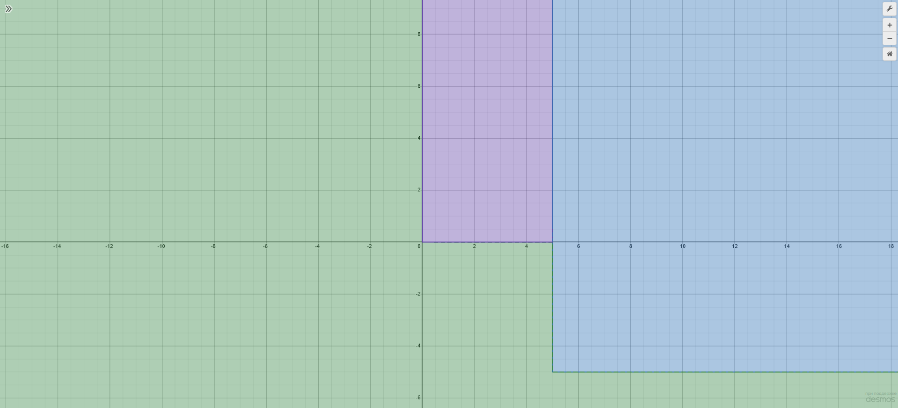

# Языки программирования
## Лабораторная работа 8

### Задание 1 **(2)**
*Рассмотрим программу на языке* **Python**.
```
x = [int(t) for t in input().split()]
for i in range(len(x)):
   if x[i] < i or x[i] > 2*i:
      break
print(i)
```
*Перепишите эту программу так, чтобы в ней использовался цикл* **while**, *в ней не использовалась
инструкция* **break**, *а используемый алгоритм не изменился. Полученная программа должна иметь следующий 
вид.*
```
x = [int(t) for t in input().split()]
i = 0
while i < len(x) - 1 and i <= x[i] <= 2 * i:
   i += 1
print(i)
```
*Допишите правильное логическое выражение вместо многоточия. Выражение не должно содержать оператор* **not**.

В исходной программе цикл останавливается, если число меньше i или больше 2*i. 
В while я записал условие наоборот. Пока число находится между i и 2*i включительно, я увеличиваю i.
Если дошли до последнего элемента, исходная программа в любом случае выводит его индекс. Поэтому в while остановка на len(x) - 1.

### Задание 2 **(2)**
*Рассмотрим программу на языке* **Python**.
```
x = [int(t) for t in input().split()]
for i in range(len(x)):
   if i <= x[i] < 2*i or 3*i <= x[i] < 4*i:
      break
print(i)
```
*Перепишите эту программу так, чтобы в ней использовался цикл* **while**, *в ней не использовалась
инструкция* **break**, *а используемый алгоритм не изменился. Полученная программа должна иметь следующий 
вид.*
```
x = [int(t) for t in input().split()]
i = 0

while i < len(x) - 1 and (x[i] < i or 2 * i <= x[i] < 3 * i or x[i] >= 4 * i):
    i += 1

print(i)
```
*Допишите правильное логическое выражение вместо многоточия. Выражение не должно содержать оператор* **not**.

Здесь исходная программа останавливается, если число попало в один из двух интервалов: [i, 2*i) или [3*i, 4*i). Значит, while продолжает работу в трёх случаях.
Число либо меньше i, либо находится между 2*i и 3*i, либо больше или равно 4*i. Например, число 2*i уже за пределами первого интервала, потому что правая граница в него не входит.

### Задание 3 **(2)**

*Напишите пример программы на* **Java** *с двумя вложенными циклами и инструкцией* **break** *для выхода
из двух вложенных циклов. В качестве такой программы можно взять поиск первого нуля в двумерном массиве.*

```
public class Main {
    public static void main(String[] args) {
        int[][] a = {
            {3, 8, 2},
            {4, 0, 7},
            {0, 5, 6}
        };

        int row = -1;
        int col = -1;

        search:
        for (int i = 0; i < a.length; i++) {
            for (int j = 0; j < a[i].length; j++) {
                if (a[i][j] == 0) {
                    row = i;
                    col = j;
                    break search;
                }
            }
        }

        if (row == -1) {
            System.out.println("Zero not found");
        } else {
            System.out.println(row + " " + col);
        }
    }
}
```

Внешний цикл перебирает строки массива, а внутренний — элементы каждой строки. Когда находится первый ноль, сохранются его координаты и выполняется break search.
Метка search стоит у внешнего цикла, поэтому программа сразу выходит из обоих циклов. В примере первый ноль находится во второй строке и втором столбце, поэтому выводится 1 1. Индексы начинаются с нуля.

### Задание 4 **(2)**

*Рассмотрим программу на языке* **Python**.
```
a = list(range(10))
b = [a.pop() - x for x in a]
print(*b)
```
*Объясните, почему список* **b** *получился именно таким.*

Цикл берёт числа с начала списка, а pop() в это же время удаляет числа с конца. На первом шаге получается 9 - 0, на втором — 8 - 1, дальше 7 - 2, 6 - 3 и 5 - 4. 
После этого в списке остаются только числа от 0 до 4. Цикл уже собирается взять элемент с индексом 5, но такого элемента больше нет, поэтому он заканчивается.

### Задание 5 **(2)**

*Напишите программу на С++, которая прочитает натуральное число* **n**, *создаст вектор
из* **n** *элементов, прочитает значения элементов, добавит последний элемент вектора к каждому элементу 
(в том числе и к последнему), найдет и выведет количество положительных и отрицательных элементов вектора
после изменения. Из циклов в программе можно использовать только циклы по коллекции.*

```
#include <iostream>
#include <vector>

int main() {
    int n;
    std::cin >> n;

    std::vector<long long> x(n);

    for (long long& value : x) {
        std::cin >> value;
    }

    const long long last = x.back();

    for (long long& value : x) {
        value += last;
    }

    int positive = 0;
    int negative = 0;

    for (long long value : x) {
        if (value > 0) {
            ++positive;
        } else if (value < 0) {
            ++negative;
        }
    }

    std::cout << positive << ' ' << negative << '\n';
}
```

Сначала считываются все числа, потом сохранется последнее в отдельную переменную. Так остаётся его исходное значение, даже когда оно прибавлется к самому последнему элементу. 
Первые два цикла работают с элементами по ссылке, чтобы можно было записывать в вектор. В последнем цикле считаются числа больше и меньше нуля. Сам ноль никуда не засчитывается.

### Задание 6 **(3)**

*Представим, что в некотором будущем стандарте* **С++** *появится конструкция*
```
forc(i, from, to)
```
*которая будет раскрываться в следующий код.*
```
{
   int __i = from, __n=to;
   for(const int &i= __i; i < __n; __i++) {
      ...
   }
}
```
*Чем эта конструкция отличается от стандартного цикла* **for**? *Укажите два основных различия.
Напишите программы для демонстрации этих различий.*

*Написанные программы сохраните в папку с номером задания.*

Первое отличие — как меняется счётчик. В обычном цикле с int i я могу написать ++i прямо в теле. В forc переменная i объявлена как const int&, поэтому через неё можно только посмотреть текущее значение. 
Сам внутренний счётчик всё равно увеличивается после каждого прохода.

Второе отличие — когда берётся верхняя граница. В обычном цикле с условием i < to значение to проверяется каждый раз.
В forc оно копируется перед началом цикла. В моём примере to сначала равно 3, а после первого прохода я меняю его на 1. 
Обычный цикл успевает вывести только 0, а forc использует сохранённую границу 3 и выводит 0 1 2.

### Задание 7 **(2)**

*Напишите программу на языке* **Python** *для проверки того, что все числа во введенной 
последовательности неотрицательные. Если в цикле будет найдено отрицательное число, цикл должен
прерваться и вывести найденное число. Если отрицательных чисел нет, то вывести некоторое сообщение об этом.*

*Программа должна использовать конструкцию* **for break else**.

*Запишите аналогичную программу на С++. Какие изменения в алгоритме решения в ней появились?. Почему?*

*Написанные программы сохраните в папку с номером задания.*

Я перебираю числа слева направо. Как только нахожу отрицательное, вывожу его и останавливаю цикл через break. В Python блок else у цикла срабатывает, если break ни разу не выполнился. 
В C++ такого else у цикла нет, поэтому я добавил переменную found. Если после цикла она всё ещё равна false, значит, отрицательных чисел не было.

### Задание 8 **(2)**

*Рассмотрим следующую программу.* 
```
if x>=5 and y>=-5:
   print(0)
elif x<0 or y<0:
   print(1)
else:
   print(2)
```
*Нарисуйте на координатной плоскости множества значений при которых программа выводит 0, 1 и 2.*
*Фотографию рисунка вставьте в отчет*
*Опишите эти множества значений, используя язык теории множеств. Например,*

A = { (x,y)| x ∈ [5;∞), y ∈ [-5;∞)}.



Сначала проверяется условие для 0. Например, точка (6, -2) даёт 0, хотя для неё тоже верно y < 0. До elif программа в этом случае уже не доходит.
Вывод 0 — \(A=\{(x,y)\in\mathbb R^2\mid x\ge5,\ y\ge-5\}\).
Вывод 1 — \(B=\{(x,y)\in\mathbb R^2\mid x<0\ \lor\ (0\le x<5\ \land\ y<0)\ \lor\ (x\ge5\ \land\ y<-5)\}\).
Вывод 2 — \(C=\{(x,y)\in\mathbb R^2\mid 0\le x<5,\ y\ge0\}\).

###  Задание 9 **(3)**
*Напишите программу на языке Python для решения следующей задачи.*

*Задана пронумерованная последовательность логических значений* **t(0), t(1), ..., t(n)**, **t(i) ∈ {False, True}**

*Последовательность обладает следующим свойством: существует некоторое число k такое, что 
все значения* **t(0), t(1), ..., t(k-1)** *равны* **False**, *а все значения* **t(k), ..., t(n)** *равны* **True**,
*то есть слева от* **k** *находятся значения* **False**, *а справа* - **True**. *Последовательность задается
функцией* **t(i)**, *которая возвращает логическое значение. Например, для тестирования эту функцию можно
задать следующим образом.*
```
def t(i):
   return i >= 1000
```

*Требуется написать программу, которая найдет число* **k**. *Программа должна реализовывать алгоритм 
бинарного поиска. Диапазон поиска задается переменными* **left** и **right**. *На каждом шаге вычисляется
центр диапазона, значение в нем проверяется, после чего диапазон сокращается в два раза.*

*Алгоритм должен быть записан через цикл* **while** *и реализовывать инвариант цикла*

t(left)=False ∧ t(right)=True

```
def t(i):
    return i >= 1000


left = -1
right = 10**18

while right - left > 1:
    mid = (left + right) // 2

    if t(mid):
        right = mid
    else:
        left = mid

print(right)
```

Я держу две границы. Слева значение False, справа — True. На каждом шаге проверяю середину. Если там True, двигаю правую границу к середине, потому что первый True может быть там или левее. 
Если там False, двигаю левую границу, потому что ответ находится правее. Когда границы становятся соседними, правая указывает на первый True. Для функции из задания это 1000.