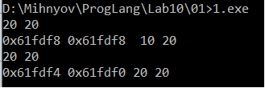
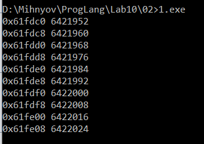
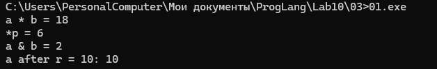
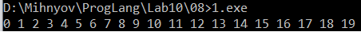
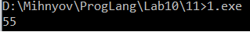

# Языки программирования

## Лабораторная работа 10

### Задание 1 **(2)**

*Рассмотрите следующие фрагменты программ. Запишите, что означают символы `&` и `*` в каждом случае применения.*

```cpp
int a = 10, b = 20;
int *p = &a, *q = &b;
p = q;
std::cout << *p << ' ' << *q << std::endl;
```

```cpp
int a = 10, b = 20;
int *p = &a, *q = &b;
*p = *q;
std::cout << *p << ' ' << *q << std::endl;
```

*Чем различаются присваивания в третьей строке? Что можно вывести, чтобы показать различия?*

**Ответ**

В выражениях `&a` и `&b` оператор `&` получает адрес переменной.

В объявлениях `int *p` и `int *q` символ `*` показывает, что переменные являются указателями на `int`.

В выражениях `*p` и `*q` оператор `*` разыменовывает указатель, то есть обращается к переменной по хранящемуся адресу.

Присваивания различаются следующим образом:

- `p = q` копирует адрес из `q` в `p`. После этого оба указателя указывают на `b`. Значения `a` и `b` не изменяются.
- `*p = *q` копирует значение переменной `b` в переменную `a`. Адреса в указателях не изменяются.

В обоих случаях первая строка вывода одинакова:

```text
20 20
```

Для демонстрации различий нужно дополнительно вывести сами указатели и значения `a` и `b`.

**Программа**

```cpp
#include <iostream>

int main() {
    {
        int a = 10, b = 20;
        int *p = &a, *q = &b;

        p = q;

        std::cout << *p << ' ' << *q << '\n';
        std::cout << "p = " << p << ", q = " << q << '\n';
        std::cout << "a = " << a << ", b = " << b << '\n';
    }

    {
        int a = 10, b = 20;
        int *p = &a, *q = &b;

        *p = *q;

        std::cout << *p << ' ' << *q << '\n';
        std::cout << "p = " << p << ", q = " << q << '\n';
        std::cout << "a = " << a << ", b = " << b << '\n';
    }
}
```

В первом блоке адреса в `p` и `q` совпадают, `a = 10`, `b = 20`.

Во втором блоке адреса различаются, `a = 20`, `b = 20`.



### Задание 2 **(1)**

*Рассмотрим следующую программу.*

```cpp
double x[10];
for (int i = 0; i < 10; i++)
    std::cout << &x[i] << std::endl;
```

*Что она выводит? Измените вывод так, чтобы адреса выводились в десятичной системе счисления. Объясните, почему числа составляют арифметическую прогрессию с определённым шагом.*

**Ответ**

Программа выводит адреса десяти элементов массива `x`. При обычном выводе указателей адреса обычно представлены в шестнадцатеричной системе счисления.

Для десятичного вывода можно преобразовать указатель к целочисленному типу `std::uintptr_t` из заголовка `<cstdint>`.

**Программа**

```cpp
#include <iostream>
#include <cstdint>

int main() {
    double x[10];

    for (int i = 0; i < 10; i++) {
        std::cout << &x[i] << ' '
                  << std::dec
                  << reinterpret_cast<std::uintptr_t>(&x[i])
                  << '\n';
    }

    return 0;
}
```

Элементы массива расположены в памяти последовательно. Адрес каждого следующего элемента отличается от предыдущего на размер одного элемента — `sizeof(double)` байт.

При `sizeof(double) = 8` десятичные адреса образуют арифметическую прогрессию с шагом 8.

Начальный адрес может изменяться при разных запусках программы.



### Задание 3 **(2)**

*Токен `*` в языке C++ может использоваться в трёх различных случаях. Аналогично токен `&` также может использоваться в трёх случаях. Приведите пример одной программы, в которой они были бы использованы во всех случаях.*

**Программа**

```cpp
#include <iostream>

int main() {
    int a = 6;
    int b = 3;

    int *p = &a;
    int &r = a;

    std::cout << "a * b = " << a * b << '\n';
    std::cout << "*p = " << *p << '\n';
    std::cout << "a & b = " << (a & b) << '\n';

    r = 10;

    std::cout << "a after r = 10: " << a << '\n';

    return 0;
}
```

**Использование `*`**

| Пример | Назначение |
| --- | --- |
| `int *p` | Объявление указателя на `int` |
| `*p` | Разыменование указателя |
| `a * b` | Умножение |

**Использование `&`**

| Пример | Назначение |
| --- | --- |
| `&a` | Получение адреса переменной |
| `int &r = a` | Объявление ссылки на переменную |
| `a & b` | Побитовое И |

Число 6 имеет двоичную запись `110`, число 3 — `011`. Результат побитового И — `010`, то есть 2.

Ссылка `r` является другим именем переменной `a`, поэтому присваивание `r = 10` изменяет `a`.

**Результат**

```text
a * b = 18
*p = 6
a & b = 2
a after r = 10: 10
```



### Задание 4 **(2)**

*Выпишите значения всех переменных, в том числе указателей, после выполнения каждой инструкции программы. Объясните, что происходит в результате выполнения каждой инструкции.*

```cpp
unsigned a = 8, b = 3, c = 17;
unsigned *p = &a;
unsigned *q = &b;
*p += *q + c;
c = *q;
p = &c;
c += a;
*p += 10;
*q = *p;
q = p;
*q += 10;
```

**Ответ**

Значения указателей обозначены адресами переменных: `&a`, `&b`, `&c`. Конкретные числовые адреса зависят от запуска программы.

| Инструкция | a | b | c | p | q | Пояснение |
| --- | --- | --- | --- | --- | --- | --- |
| `unsigned a = 8, b = 3, c = 17;` | 8 | 3 | 17 | — | — | Объявлены три переменные |
| `unsigned *p = &a;` | 8 | 3 | 17 | `&a` | — | `p` указывает на `a` |
| `unsigned *q = &b;` | 8 | 3 | 17 | `&a` | `&b` | `q` указывает на `b` |
| `*p += *q + c;` | 28 | 3 | 17 | `&a` | `&b` | `a = 8 + 3 + 17 = 28` |
| `c = *q;` | 28 | 3 | 3 | `&a` | `&b` | В `c` записано значение `b` |
| `p = &c;` | 28 | 3 | 3 | `&c` | `&b` | Теперь `p` указывает на `c` |
| `c += a;` | 28 | 3 | 31 | `&c` | `&b` | `c = 3 + 28 = 31` |
| `*p += 10;` | 28 | 3 | 41 | `&c` | `&b` | Через `p` значение `c` увеличено на 10 |
| `*q = *p;` | 28 | 41 | 41 | `&c` | `&b` | В `b` записано значение `c` |
| `q = p;` | 28 | 41 | 41 | `&c` | `&c` | Теперь оба указателя указывают на `c` |
| `*q += 10;` | 28 | 41 | 51 | `&c` | `&c` | Через `q` значение `c` увеличено на 10 |

Итоговые значения:

```text
a = 28
b = 41
c = 51
p = &c
q = &c
*p = 51
*q = 51
```

### Задание 5 **(1)**

*Что сравнивается в приведённой ниже программе? Как можно изменить первую строчку программы, чтобы результат тоже изменился?*

```cpp
int x = 1, y = 2;
int *p = &y, *q = &x;

if (p < q)
    std::cout << "Yes";
else
    std::cout << "No";
```

**Ответ**

Сравниваются указатели `p` и `q`, то есть адреса переменных `y` и `x`, а не значения 2 и 1.

Изменение значений `x` и `y` само по себе не меняет адреса этих переменных и не позволяет управлять результатом сравнения.

В качестве эксперимента первую строку можно заменить на:

```cpp
static int x = 1, y = 2;
```

Именно такой вариант используется в программе из папки `05`.

Добавление `static` меняет время хранения переменных и может изменить их расположение в памяти. Поэтому на конкретном компиляторе результат сравнения может поменяться.

Однако стандарт C++ не задаёт порядок адресов двух отдельных переменных. Для исходной программы нельзя гарантировать вывод `Yes` или `No`.

Чтобы получить определённый результат, можно использовать элементы одного массива.

**Вариант с гарантированным выводом `Yes`**

```cpp
#include <iostream>

int main() {
    int v[2] = {1, 2};
    int &x = v[1], &y = v[0];

    int *p = &y, *q = &x;

    if (p < q)
        std::cout << "Yes";
    else
        std::cout << "No";

    return 0;
}
```

Здесь `p` указывает на первый элемент массива, а `q` — на второй. Поэтому `p < q` истинно.

Если заменить объявление ссылок на:

```cpp
int &x = v[0], &y = v[1];
```

программа гарантированно выведет `No`.

### Задание 6 **(2)**

*Объясните работу следующей программы. Как изменится результат, если тип `double` изменить на некоторый другой, например `int` или `char`?*

```cpp
double x = 0;
double *d = &x;

std::cout << reinterpret_cast<size_t>(d + 4)
           - reinterpret_cast<size_t>(d - 4)
          << std::endl;
```

**Ответ**

При сложении указателя с целым числом смещение измеряется в элементах соответствующего типа.

Для указателя типа `T*`:

- `d + 4` означает смещение на четыре элемента вперёд;
- `d - 4` означает смещение на четыре элемента назад.

При обычном представлении адресов расстояние между этими позициями в байтах рассчитывается так:

```text
8 * sizeof(T)
```

После преобразования адресов к целому типу программа пытается найти именно разницу их числовых представлений.

Для распространённых размеров типов ожидаются следующие значения:

| Тип | Размер элемента | Ожидаемая разница адресов |
| --- | --- | --- |
| `double` | 8 байт | 64 |
| `int` | 4 байта | 32 |
| `char` | 1 байт | 8 |

Размеры `double` и `int` зависят от реализации. `sizeof(char)` всегда равен 1.

**Особенность исходной программы**

Переменная `x` является отдельным объектом. Вычисления `d + 4` и `d - 4` выходят за допустимые границы арифметики указателей, поэтому исходная программа имеет неопределённое поведение. Значения 64, 32 и 8 нельзя считать гарантированным результатом такого кода.

Для корректной демонстрации нужно создать массив и установить указатель на его середину.

**Исправленная программа**

```cpp
#include <iostream>
#include <cstdint>

int main() {
    {
        double x[9] = {};
        double *d = x + 4;

        std::cout << "double: "
                  << reinterpret_cast<std::uintptr_t>(d + 4)
                     - reinterpret_cast<std::uintptr_t>(d - 4)
                  << '\n';
    }

    {
        int x[9] = {};
        int *d = x + 4;

        std::cout << "int: "
                  << reinterpret_cast<std::uintptr_t>(d + 4)
                     - reinterpret_cast<std::uintptr_t>(d - 4)
                  << '\n';
    }

    {
        char x[9] = {};
        char *d = x + 4;

        std::cout << "char: "
                  << reinterpret_cast<std::uintptr_t>(d + 4)
                     - reinterpret_cast<std::uintptr_t>(d - 4)
                  << '\n';
    }

    return 0;
}
```

Здесь `d - 4` указывает на первый элемент массива, а `d + 4` — на последний. Оба указателя остаются внутри массива.

При обычном представлении адресов и размерах типов 8, 4 и 1 байт результат:

```text
double: 64
int: 32
char: 8
```

Преобразование указателя в целое число зависит от реализации. Переносимый способ вычислить расстояние в байтах внутри этого массива:

```cpp
std::cout << ((d + 4) - (d - 4)) * sizeof(*d);
```

### Задание 7 **(2)**

*Объясните работу следующей программы. Как изменится результат, если тип `double` изменить на некоторый другой, например `int` или `char`?*

```cpp
std::cout << reinterpret_cast<double*>(3000)
           - reinterpret_cast<double*>(2000)
          << std::endl;
```

**Ответ**

Числа 3000 и 2000 преобразуются к указателям типа `double*`. Затем выполняется вычитание указателей.

При допустимом вычитании указателей результат измеряется в количестве элементов, а не в байтах.

Если рассматривать числа как обычные байтовые адреса, предполагаемый расчёт имеет вид:

```text
(3000 - 2000) / sizeof(T)
```

Для распространённых размеров типов:

| Тип указателей | Размер элемента | Предполагаемый результат |
| --- | --- | --- |
| `double*` | 8 байт | 125 |
| `int*` | 4 байта | 250 |
| `char*` | 1 байт | 1000 |

В программе из папки `07` используется `char*`, поэтому ожидаемый при таком расчёте результат — 1000.

**Особенность исходной программы**

Вычитание указателей определено для элементов одного массива, включая позицию сразу после его конца. Преобразование чисел 3000 и 2000 в указатели не создаёт массив и не обеспечивает выполнение этого условия.

Поэтому исходная программа имеет неопределённое поведение, а значения из таблицы показывают только предполагаемый расчёт.

**Корректный пример вычитания указателей**

```cpp
#include <iostream>

int main() {
    double a[126] = {};
    int b[251] = {};
    char c[1001] = {};

    std::cout << "double: " << &a[125] - &a[0] << '\n';
    std::cout << "int: " << &b[250] - &b[0] << '\n';
    std::cout << "char: " << &c[1000] - &c[0] << '\n';

    return 0;
}
```

**Результат**

```text
double: 125
int: 250
char: 1000
```

В этом примере каждая пара указателей относится к одному массиву, поэтому вычитание корректно.

### Задание 8 **(2)**

*Что надо дописать в записанной ниже программе вместо многоточий, чтобы она выводила все числа из массива `a`? Почему?*

```cpp
int a[20];

for (int i = 0; i < 20; i++)
    a[i] = i;

int *b = a + 8;

for (int i = ...; i < ...; i++)
    std::cout << b[i] << ' ';
```

**Ответ**

Нужно указать начальное значение `-8` и верхнюю границу `12`:

```cpp
for (int i = -8; i < 12; i++)
    std::cout << b[i] << ' ';
```

Указатель `b` указывает на элемент `a[8]`.

Обращение `b[i]` равнозначно `*(b + i)`, поэтому:

```text
b[i] = a[8 + i]
```

Чтобы получить все элементы от `a[0]` до `a[19]`, индекс `i` должен изменяться от `-8` до `11` включительно:

```text
b[-8] = a[0]
b[0]  = a[8]
b[11] = a[19]
```

Отрицательные индексы здесь допустимы: итоговые обращения остаются в пределах массива `a`.

**Программа**

```cpp
#include <iostream>

int main() {
    int a[20];

    for (int i = 0; i < 20; i++)
        a[i] = i;

    int *b = a + 8;

    for (int i = -8; i < 12; i++)
        std::cout << b[i] << ' ';

    return 0;
}
```

**Результат**

```text
0 1 2 3 4 5 6 7 8 9 10 11 12 13 14 15 16 17 18 19
```



### Задание 9 **(2)**

*Что выводит следующая программа? Изменится ли результат, если изменить тип элементов массива?*

```cpp
int a[10];
std::cout << &a[8] - &a[3] << std::endl;
```

**Ответ**

Программа выводит:

```text
5
```

При вычитании указателей на элементы одного массива получается разность их индексов:

```text
8 - 3 = 5
```

Результат измеряется в элементах массива, поэтому при замене типа `int` на `double` или `char` он останется равным 5.

Расстояние в байтах при этом может измениться: оно равно `5 * sizeof(T)`.

**Программа для проверки**

```cpp
#include <iostream>

int main() {
    int a[10];
    double b[10];
    char c[10];

    std::cout << &a[8] - &a[3] << '\n';
    std::cout << &b[8] - &b[3] << '\n';
    std::cout << &c[8] - &c[3] << '\n';

    return 0;
}
```

**Результат**

```text
5
5
5
```

Элементы массивов не инициализированы, но их значения не считываются: используются только адреса.

### Задание 10 **(1)**

*Есть ли разница между инициализацией `p` и `q` в следующей программе? Обоснуйте ответ.*

```cpp
int x[10] = {1, 2, 3, 4, 5, 6, 7, 8, 9, 10};
int *p = x + 5;
int *q = &x[5];
```

**Ответ**

По результату разницы нет. Оба указателя получают адрес элемента `x[5]`.

В выражении `x + 5` массив преобразуется в указатель на первый элемент, после чего указатель смещается на пять элементов вперёд.

В выражении `&x[5]` непосредственно получается адрес элемента с индексом 5.

Следовательно:

```cpp
p == q
*p == 6
*q == 6
```

Индексация начинается с нуля, поэтому `x[5]` — шестой элемент массива.

**Программа для проверки**

```cpp
#include <iostream>

int main() {
    int x[10] = {1, 2, 3, 4, 5, 6, 7, 8, 9, 10};

    int *p = x + 5;
    int *q = &x[5];

    std::cout << std::boolalpha << (p == q) << '\n';
    std::cout << *p << ' ' << *q << '\n';

    return 0;
}
```

**Результат**

```text
true
6 6
```

### Задание 11 **(3)**

*Указатели можно использовать для итерации по массивам. Напишите программу, которая найдёт сумму элементов массива, используя указатели. В начале цикла указатель требуется установить на начало массива, в конце каждой итерации смещать его к следующему элементу через инкремент. Для выхода из цикла надо проверять, что указатель дошёл до конца массива.*

```cpp
int x[10] = {1, 2, 3, 4, 5, 6, 7, 8, 9, 10};
int s = 0;

for (int *p = ...; ...; ...)
    s += ...;

std::cout << s;
```

**Программа**

```cpp
#include <iostream>

int main() {
    int x[10] = {1, 2, 3, 4, 5, 6, 7, 8, 9, 10};
    int s = 0;

    for (int *p = x; p < x + 10; p++)
        s += *p;

    std::cout << s;

    return 0;
}
```

**Пояснение**

При инициализации `int *p = x` указатель устанавливается на первый элемент массива.

Условие `p < x + 10` проверяет, что указатель ещё не дошёл до позиции сразу после последнего элемента.

Выражение `s += *p` прибавляет к сумме значение текущего элемента.

Операция `p++` перемещает указатель к следующему элементу массива.

Указатель `x + 10` допустимо использовать для проверки окончания обхода, но разыменовывать его нельзя.

**Результат**

```text
55
```


